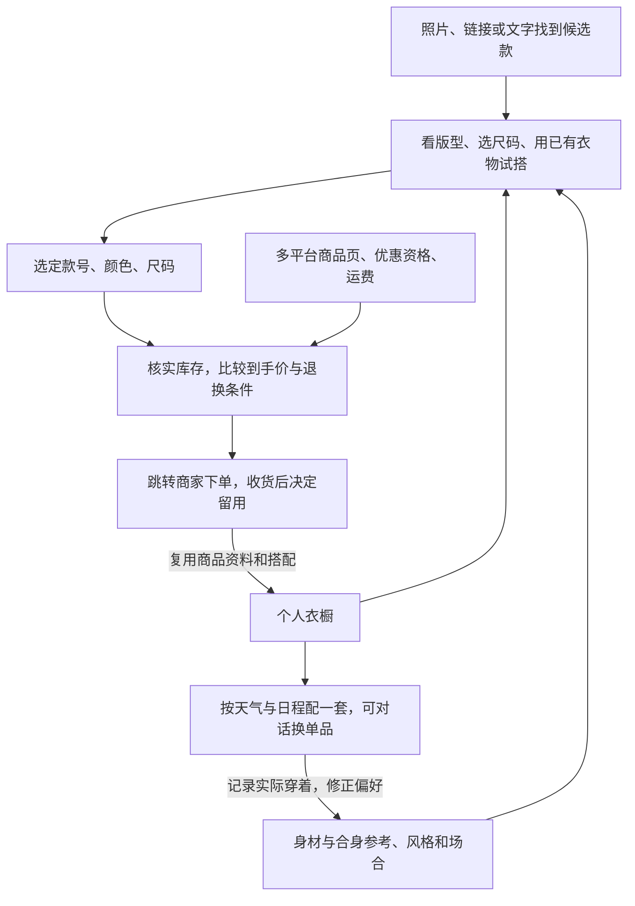

# 穿好

**从挑衣比价到日常搭配，你的 AI 衣橱管家**

看中一件夹克，你也许会问：“这款肩膀会不会紧？里面还能加一件毛衣吗？”买之前，你用自己的牛仔裤和皮鞋试搭，喜欢这一身，就把它存下来。选好颜色和尺码，再看看哪家店买更合算。

收到夹克后，你准备穿它去上班。打开买前存好的那套搭配，你只想换双鞋：“今天要走很多路，夹克和牛仔裤照旧，配哪双运动鞋好？”

**我们计划做一款面向日常服装消费者的手机 App。** 挑衣时，它把用户自愿提供的身材信息、穿衣习惯与商品尺码表放在一起，给出版型和尺码建议，再用已有衣物试搭。购买时，它从多个平台核对同款、同色、同尺码的库存与报价，算清用户实际可享的价格。收货后，选中的衣物和搭配一起进入个人衣橱，继续用于每天出门前的选择。

## 谁会用，哪一步最费力

我们首先关注**自己买衣、在多个平台间做选择，也需要为通勤、见朋友或出游搭配衣服的人**。这类需求可以落到三个具体时刻，访谈时也能请用户回忆真实经过。

| 时刻 | 用户想弄清什么 | 为什么值得解决 |
| --- | --- | --- |
| 看到喜欢的款式 | “模特穿着好看，我穿会怎样？配得上我常穿的裤子吗？” | 同样标 M 码，不同款式的肩宽、衣长可能不同。商品展示图也很少出现用户已有的衣服。 |
| 准备下单 | “页面上写的最低价，我选深绿 M 码还能拿到吗？” | 起售价可能对应其他规格；缺货、会员券、运费和退换条件都可能改变选择。 |
| 收到衣服，准备出门 | “买时想好的一套放哪儿了？今天下雨，能只换鞋吗？” | 订单记下了买了什么，截图保存了当时的灵感，实际哪件合身、哪一套好穿，又是另一份信息。 |

## 对着四格图走一遍产品

**第一格 · 看中一件，找到可选的款。** 路过橱窗拍下绿夹克，或把商品链接发给「挑衣」。也可以直接说“想找四百元以内、通勤穿的短外套”。助手列出候选，允许纠正颜色和款式。视觉相似的衣服可用于发现款式；进入同款比价前还要核实商品身份。

**第二格 · 先判断怎么选，再算怎么买。** 这是手机上两张用途不同的卡片，也是产品最重要的一步。

| | 适合我吗？ | 哪家买合算？ |
| --- | --- | --- |
| 依据 | 我选填的身高、肩宽或常穿尺码，一件已知合身的外套，喜欢的松量、风格和场合；候选款的尺寸、剪裁；衣橱里可搭的单品。 | 各平台的品牌款号、颜色、尺码、库存、标价、可用优惠、运费、退换说明及核实时间。 |
| 怎么用 | 我说“肩部想宽松些，里面会加毛衣”。助手把商品尺码表与我的参考外套对照，指出需要留意的肩宽和胸围，再把夹克与我的牛仔裤拼成一套。缺尺寸时，标出还需要哪项信息。 | 我选定深绿 M 码，系统只把能核实为这一规格、且有货的报价放在一起。能用的券计入到手价，会员专享价注明资格，店铺链接供下单前复核。 |
| 得到什么 | 建议试哪个码、为什么、有哪些现成搭配。我可以保留裤子，再看看另一件上衣。 | 可以比较的到手价和购买条件。我可以选择更便宜的店，也可以为更方便的退换货多付一点。 |

举个**演示用报价**：同一款深绿 M 码，甲店标价 399 元，包邮，我有一张可用的 30 元券，到手 369 元；乙店标价 379 元，运费 8 元，到手 387 元。如果我没有那张券，乙店反而便宜 12 元。这个结论取决于店铺报价和我的优惠资格；肩宽、穿衣风格和那条牛仔裤影响的是前一张卡片的建议。

**第三格 · 收到以后，决定留不留。** 从报价卡跳到商家下单，回到“穿好”可把候选标为“已买待收”。试穿后点“留下”，已确认的商品资料、实购尺码和买前保存的搭配一起进入「我的衣橱」。若退货，就从可穿清单里移除。用户也能直接拍照录入家里已有的衣物，修改标签，或标记某件正在洗。

**第四格 · 今天怎么穿，可以接着聊。** 打开「今天穿什么」，说“降温了，还要步行通勤，保留绿夹克”。助手结合天气、场合、个人偏好和衣橱里可用的衣服推荐整套，支持用文字或语音继续要求“裤子不动，只换双好走路的鞋”。实际穿过后，可记录“这套合适”或“这件叠穿肩部偏紧”，让下一次建议用得上这条经验。首版用单品拼图展示搭配；本人照片的虚拟试衣作为扩展，合身程度仍以尺寸对照和实际试穿反馈为准。

## 市面上的方案解决到哪一步

我们查阅了六款产品的开发者说明。比较对象涵盖购物比价和衣橱穿搭，也特意选入了已经做到**买前搭配决策**的产品。下面记录的是公开功能对照，后续会用同一件外套做操作验证。

### 购物与比价工具

| 产品 | 已有能力 | 放到这件夹克上，还要自己做什么 |
| --- | --- | --- |
| **慢慢买** | 支持拍照搜同款、跨平台比价、历史价格和降价提醒。 | 能从一张图走到商品和价格。找到好价后，公开介绍没有展示怎样用自己的身材参考、牛仔裤和鞋判断是否适合，再将试搭结果留到收货后使用。[开发者介绍](https://app.mi.com/details?id=com.manmanbuy.bijia) |
| **购物党** | 从商品链接查同款价格、历史走势和优惠券，购后还能跟踪价保。 | 它能继续回答“买贵了能否补差价”。至于这件 M 码穿着是否紧、留下之后配过哪几套，用户还需另行记录。[开发者介绍](https://app.mi.com/details?id=com.gwdang.app) |
| **识货** | 面向潮鞋、服饰等品牌商品，提供购买渠道推荐和商品鉴别服务。 | 适合判断一件品牌服装从哪个渠道买更放心。其公开介绍聚焦商品与渠道，没有展示收货后如何用个人衣橱持续安排通勤穿搭。[开发者介绍](https://apps.apple.com/cn/app/id875177200) |

### 穿搭与数字衣橱工具

| 产品 | 已有能力 | 放到这件夹克上，还要自己做什么 |
| --- | --- | --- |
| **Acloset** | 可从照片建衣橱、导入订单，也可从商品页收藏待购款，用自己的衣物或虚拟形象试搭，再按天气和场合推荐。 | 已经找到夹克的商品页时，它能帮助判断怎么搭。若手上只有街拍，还想找到多家平台可买的同款并核算指定色码的到手价，官方资料未展示这一过程。[官方 FAQ](https://www.acloset.app/support/) · [购物扩展](https://www.acloset.app/extension/) |
| **尽简衣橱** | 擅长单品整理、搭配拼图、穿搭日历和衣橱统计，还能记录购入价格。 | 能查自己何时穿过夹克、当初花了多少钱。买前哪家有目标尺码、今天的券后价是多少，仍需查询商家报价。[产品官网](https://closet.jinjian.tech/zh-Hans) |
| **享搭衣橱** | “帮我选”支持拍下待购衣物，对照现有衣橱判断风格、场景和重复程度，推荐搭配并记录购买决定。 | 它已经能回答“买了能搭什么”，与我们的构想最接近。其公开说明没有展示从候选图匹配多平台在售同款、核对色码和库存、再比较到手价的步骤。[开发者介绍](https://apps.apple.com/tw/app/%E4%BA%AB%E6%90%AD%E8%A1%A3%E6%A9%B1/id6820797097) |

**为什么还要做“穿好”？** 用户在穿搭工具里选中的，是“适合我、能和这条裤子搭的深绿 M 码”；到了购物工具里，必须再确认眼前报价对应的正是这件；收货后还得找回原来的搭配。“穿好”把**选定的具体款式和规格**一路保留下来。用户能知道两件事各自的理由：为什么推荐我试这件，为什么今天这家店更合算。收货后还能看见当时的选择是否真的穿得上。能否减少跨应用切换、重复核对和重新录入，是我们要用调研和实测回答的问题。

## 项目章程 · 过程模型选型草案

**建议采用迭代式增量开发。** 第一版只靠用户自己的衣物，就能演示为一次通勤选衣、换鞋和保存搭配；第二版接入待购物品和可核实的报价；第三版沿用同一件衣物与搭配记录，处理收货、退货和穿着反馈。这样每轮都有用户能亲手完成的任务。最不确定的是能否持续拿到同款、同色、同尺码的有效报价，取样验证应在第一轮就开始，结果用来决定第二轮支持的商品和平台范围。[跨店报价风险记录](https://github.com/MXH814/DressWell/issues/1)

| 比较的过程模型 | 放在本项目里会怎样 |
| --- | --- |
| 瀑布模型 | 若需求和数据接口已经稳定，一次确定规格便于分工。当前连哪些规格可以跨平台核验都需要试查，过早定下平台范围，后续可能同时返工采集、排序和界面。 |
| 螺旋模型 | 适合先用原型消除重大风险。我们可以借用它的做法，提前验证报价来源；衣橱录入、收货状态等环节则已有清晰的演示任务，五人小组逐项组织完整风险分析的成本较高。 |
| 迭代式增量开发 | 三段任务能分别交付，又要复用衣物、规格与搭配记录。每轮让成员按同一故事实际操作，发现规格或状态不一致时，能在下一段功能依赖它之前修正。 |

建议每轮由组长确定交付故事及其 Issue，需求与测试负责人写清怎样算通过；开发成员用 PR 提交可运行的改动，其他成员评审。轮末用真实操作核对验收结果，保留测试、演示和回顾记录，达到交付条件后标记对应版本。若数据验证失败，记录失败样例并调整下一轮范围。下表列出三个增量，[风险清单](docs/project-risks.md)列出每轮需要提前验证的条件。

本节和风险清单由 Codex 依据仓库材料整理为评审草案。团队成员在 [#1](https://github.com/MXH814/DressWell/issues/1) 关联的章程 PR 中记录实际选择、取舍理由和责任人。

## 课程项目如何落地

| 可交付增量 | 演示任务 | 判断做成了什么 |
| --- | --- | --- |
| **v0.1 个人档案、衣橱与日常搭配** | 录入穿衣偏好和几件自有衣物，为一次通勤配一套，再要求只换鞋。 | 推荐来自可穿的衣物，能解释选择，保留的单品在多轮对话中不变。 |
| **v0.2 找款、试搭与多平台比价** | 从一件夹克的照片或链接出发，对照尺码表，用已有衣物试搭；选定规格后比较两家报价。 | 用户能区分尺码建议的依据与价格计算的依据；相似款、缺货码和用不了的优惠不会被算成最低价。 |
| **v0.3 收货入橱与穿着反馈** | 分别走一遍留用和退货，再为下周的场合生成搭配。 | 留用款能找回买前的方案，退货款不出现在可穿推荐里，用户能修正系统记住的偏好。 |

**先验证两项数据条件。** 尺码建议需要能读懂的商品尺寸表，并区分人体参考尺寸和成衣实量。跨店比价则需要能复核的商品身份、规格、优惠条件和时间。首轮将选少量真实商品页留存带来源的报价快照，先验证到底能比哪些款、哪些平台。演示回放标明采集时间；缺货、过期券等异常可另用标明的模拟样本测试。[选题与风险记录](https://github.com/MXH814/DressWell/issues/1)

## 第一课后怎样调研，第二课拿什么展示

目前已有选题、竞品公开资料对照、调研计划和 10 条待验证的用户故事。接下来要找的是用户**实际经历过**的困难，包括他们用现有软件已经解决得很好的部分。

| 节点 | 对象、方法与分工 | 可展示的证据 |
| --- | --- | --- |
| 第二课前第 4 至第 3 天 | 计划访谈约 6 位近期买过、放弃购买或退过衣服的人。一人提问、一人记录。请对方复盘最近一次选码、核价、收货和实际穿着，追问哪一步改变了决定。 | 匿名纪要，保留操作顺序、原话、反例及证据编号。 |
| 第二课前第 3 至第 2 天 | 从上述产品中选一款购物工具、两款衣橱工具，由一人执行、一人复核。统一使用同一张商品图、同一组身材与偏好资料、目标色码和三件已有衣物。 | 记录能否解释选码、找到几条可核实报价、切换几次或重填哪些信息，以及下次能否找回原搭配。记录版本、日期和实际限制。 |
| 第二课前 1 天至课前 | 报告作者将访谈证据与竞品任务连到用户故事，说明首版保留、修改或舍弃哪些需求；另一位成员评审后合并。 | 调研报告 PR、更新后的故事清单，以及可在课堂复述的实例。 |

五人小组由组长协调。仓库已建立三类 Issue 模板、三个增量里程碑及文档 CI，`main` 通过独立评审后合并。[仓库启动记录](https://github.com/MXH814/DressWell/issues/2) · [调研交付 Issue](https://github.com/MXH814/DressWell/issues/3) · [完整调研计划与访谈提纲](docs/research-plan.md) · [用户故事初稿](docs/story-drafts.md) · [课程检查点](docs/course.md)

**8 分钟课堂讲解**　用 1 分钟讲用户和三个问题，3 分钟对着漫画讲同一件夹克的选择、价格和去向，2 分钟重点比较慢慢买与享搭衣橱（其余四款供追问），最后各用 1 分钟交代交付增量和调研安排。
