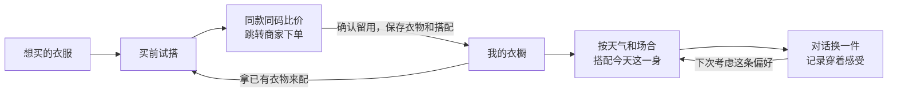

# 穿好

**从挑衣比价到日常搭配，你的 AI 衣橱管家**

看中一件外套，最先想知道的是“我穿什么码，哪家买划算”；真正决定值不值得买的，往往是“回家能配哪条裤子，下周会不会穿”。我们想做一款手机 App，让用户拿自己的衣橱回答这两个问题。

## 谁会用，为什么需要它

穿好面向平时自己挑衣、买衣、搭衣的人，覆盖上衣、外套、下装和鞋等日常穿着品类。我们从三类具体经历切入访谈，同一个人可能三种都遇到过。

| 什么时候 | 眼下怎样解决 | 希望少做哪一步 |
| --- | --- | --- |
| 逛店或刷到穿搭时，看中一件衣服 | 存图、分头找款、逐店选颜色和尺码，再算优惠 | 给出几个可买的候选，把自己能穿的规格放在一起比 |
| 对价格满意，拿不准该不该买 | 凭记忆想家里有哪些裤子和鞋，或把几张照片发给朋友看 | 下单前直接拿自己的衣物配一套，也看看衣柜里有没有近似款 |
| 收货后要出门，临时决定穿什么 | 翻找前几天的截图，重新想当时打算怎么搭 | 找回买前保存的那一身，只换掉不适合今天的一件 |

## 产品长什么样，用户怎么用

手机上有三个主要入口：**「我的衣橱」**放已拥有的衣物，**「挑衣」**放待购候选、试搭和报价，**「今天穿什么」**按天气、场合和个人喜好组一身。三个入口共用衣物资料和偏好，用户能用文字或语音继续提要求。下面用同一件绿夹克走一遍计划中的产品体验。

1. **先看家里有什么。** 我给常穿的牛仔裤、白衬衫和两双鞋拍照。系统识别品类和颜色，我可以改标签，标记哪些正在洗。我的尺码、预算、偏好的版型和“不穿硬底鞋”等要求，也可以随时修改。
2. **看到想买的，先留下再筛。** 路过橱窗拍下绿夹克，或者把商品链接贴进「挑衣」。拍照得到的是候选款，我能校正识别结果，再说“深绿、短款、四百元以内”。也可以从文字描述开始找，几件犹豫的款先放在待购清单里。
3. **把选择放回自己的衣橱里。** 点一件候选夹克，屏幕上把它和我的牛仔裤、白衬衫拼成整套。我可以问“和上次那件灰外套搭的衣服重不重复”，也可以锁定裤子，只换鞋。先做到看得见的单品拼搭；用本人照片生成的虚拟试衣列为扩展体验。
4. **决定想买，再比对我有用的价格。** 选中深绿色 M 码后，报价卡并列展示已核实同款的店铺、价格、运费、优惠门槛和核实时间。另一家店若只剩 S 码，或图片相似但款号对不上，会单独标明。选好后跳到商家页面下单。
5. **收货时，沿用买前做过的选择。** 确认购买后标记“待收货”；试穿决定留下，点“收入衣橱”，商品资料和刚才配好的那一套一起保留。退货则退出可穿清单。第二天的搭配只会用到手头能穿的衣服。
6. **到了出门那天，接着聊。** “今天降温，要通勤，还想穿那件绿夹克。”助手从衣橱里配齐一套。我说“外套和裤子保留，鞋换成走路舒服的”，它只调整鞋。实际穿了哪套、哪双鞋磨脚，都可以反馈，供下次推荐时参考。

## 已有软件能做到哪一步

我们用两个问题看竞品。**买之前，这件深绿 M 码哪家划算，能配我哪条裤子？买之后，下周能否用原来那套搭配出门？** 以下是根据开发者公开说明做的第一轮对照。

| 产品 | 已经解决的问题 | 这项任务还缺哪一步 |
| --- | --- | --- |
| **慢慢买** | 支持拍照搜同款、跨平台比价、查历史价格和降价提醒，适合找货、判断购买时机。[开发者功能介绍](https://app.mi.com/details?id=com.manmanbuy.bijia) | 查到好价以后，公开功能里没有展示怎样调出用户自己的裤子和鞋试搭，或把留下的衣服和这套搭配一起收入衣橱，供下次出门使用。 |
| **Acloset** | 能拍照识别衣物、导入订单、从商品页收藏到心愿单，用自己的衣物预搭或虚拟试穿，再按天气和场合推荐穿搭。[官方 FAQ](https://www.acloset.app/support/) · [官方购物扩展](https://www.acloset.app/extension/) | 从已有商品页出发，它能回答“配什么”。对只有一张街拍、还没有商品链接的人，官方资料没有展示如何搜到多平台可购买的候选，再并排比较指定颜色、尺码和优惠条件下的价格。 |

**穿好想省下的，是两种工具之间的重复劳动。** 用比价工具加衣橱工具，用户可以分头做完许多步骤；但需要自己核对两边是不是同一件，把选好的款式、尺码和打算怎么搭重新对应起来。穿好计划让同一件候选衣物从试搭、比价一直保留到收货和实际穿着。仅逛街比价的人已有成熟选择；我们首先要验证的是，**既在意价格、又想买回来搭得上的人，这样能少切换几次应用、少录几次资料，能否找回原来那一套。**

## 课程项目怎么分步交付

| 增量 | 上台能够演示的结果 |
| --- | --- |
| **v0.1 衣橱与日常搭配** | 录入几件自有衣物，给出天气和场合，配出一套；提出“只换鞋”后能保留其余单品。 |
| **v0.2 买前试搭与比价** | 由照片、链接或描述找到候选，用原有衣物试搭，按指定色码查看带来源、条件和时间的跨店报价。 |
| **v0.3 买后入橱与反馈** | 从待购清单走到留用或退货，找回买前的搭配；记录一次实际穿着，在下一次建议中体现该偏好。 |

比价最难的是证明“两家卖的是我想买的同一件”。首轮准备用少量可回查的真实商品页核对款号、颜色、尺码和优惠条件；有出处的报价保留快照及更新时间。信息不足的样本标为“相似款”或“待核实”。课堂演示可用快照复现比价，模拟数据用于测试缺货、优惠失效等异常。支持哪些平台，由样本核验结果决定。[技术风险与选题记录](https://github.com/MXH814/DressWell/issues/1)

## 第一课后，我们怎样验证这个选题

目前已完成仓库启动、选题说明、上述竞品资料对照、调研计划和 10 条用户故事初稿。用户痛点仍需通过真人访谈确认。下一次展示要拿得出的，是一段真实购买经过、一项能复现的竞品任务，以及它们怎样改变我们的需求取舍。

| 节点 | 对象、方法与分工 | 产出 |
| --- | --- | --- |
| 第二课前第 4 至第 3 天 | 计划约访 6 位近期买过、放弃购买或退过衣服的人，兼顾经常和很少规划穿搭的人。一人提问、一人记录。请对方复盘最近一次决定。 | 匿名纪要，保留当事人的步骤、关键原话和反例 |
| 第二课前第 3 至第 2 天 | 竞品执行者用同一件外套、目标尺码和三件已有衣物分别操作，另一人复核。记录完成到哪一步、切换次数、重复录入项和可核实报价数。 | 带版本、日期和操作证据的竞品对照 |
| 第二课前 1 天至课前 | 报告作者把访谈发现连到用户故事，由另一位成员评审并合并报告。主讲人用 8 分钟说明对谁有用、哪里有缺口、首版先做什么。 | 调研报告 PR、更新后的故事清单和汇报材料 |

组长协调五人小组的进度。仓库已为 `main` 开启分支保护，配置三类 Issue 模板、独立 PR 评审、文档 CI 和三个里程碑。[选题 Issue](https://github.com/MXH814/DressWell/issues/1) · [仓库启动记录](https://github.com/MXH814/DressWell/issues/2) · [调研交付 Issue](https://github.com/MXH814/DressWell/issues/3) · [完整调研计划与访谈提纲](docs/research-plan.md) · [10 条用户故事初稿](docs/story-drafts.md) · [课程检查点](docs/course.md)

**8 分钟讲解顺序**　用户与痛点 1 分钟 → 对着四格图讲产品 3 分钟 → 用两款竞品解释缺口 2 分钟 → 三个增量和技术风险 1 分钟 → 调研安排 1 分钟。
