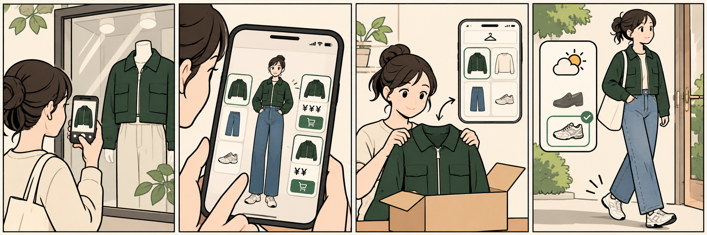
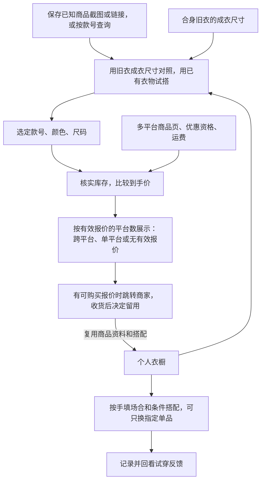

# 穿好

**从挑衣比价到日常搭配，你的 AI 衣橱管家**

“穿好”是一款为日常买衣、搭衣的人设计的手机 App。买前，用合身旧衣对照尺码，把看中的款式和自己的衣服试搭，再比较同款、同色、同码的到手价。收货后，留下的衣物进入衣橱，买前存好的那套搭配也能接着用。

## 团队分工

| 成员 | 角色 | 项目主要职责 |
| --- | --- | --- |
| **A · 马祥珲** | 组长／项目经理，兼 DevOps 负责人 | 制定迭代计划、协调分工、跟踪风险，维护 GitHub 仓库、持续集成和发布流程。 |
| **B · 胡知鱼** | 需求分析师，兼 AI 使用负责人 | 组织访谈与竞品调研，编写用户故事和需求规约，维护 AI 使用台账。 |
| **C · 唐正浩** | 架构／设计工程师，兼后端开发工程师 | 设计数据模型与接口，负责平台数据接入、同款匹配、报价计算和衣物入橱。 |
| **D · 臧真宇** | 客户端开发工程师 | 实现手机端的候选保存、试搭、比价、入橱与日常搭配，负责前后端联调。 |
| **E · 方鹭洋** | 测试／质量工程师 | 设计测试与验收用例，复核报价、库存和优惠条件，组织集成测试与评审，跟踪缺陷。 |

## 一件夹克，从看中到穿出门

看中一件夹克，你也许会问：“这款肩膀会不会紧？里面还能加一件毛衣吗？”买之前，你用自己的牛仔裤和皮鞋试搭，喜欢这一身，就把它存下来。选好颜色和尺码，再看看哪家店买更合算。

收到夹克后，你准备穿它去上班。打开买前存好的那套搭配，你只想换双鞋：“今天要走很多路，夹克和牛仔裤照旧，配哪双运动鞋好？”

## 谁会用，哪一步最费力

我们首先关注**自己买衣、在多个平台间做选择，也需要为通勤、见朋友或出游搭配衣服的人**。这类需求可以落到三个具体时刻，访谈时也能请用户回忆真实经过。

| 时刻 | 用户想弄清什么 | 为什么值得解决 |
| --- | --- | --- |
| 看到喜欢的款式 | “模特穿着好看，我穿会怎样？配得上我常穿的裤子吗？” | 同样标 M 码，不同款式的肩宽、衣长可能不同。商品展示图也很少出现用户已有的衣服。 |
| 准备下单 | “页面上写的最低价，我选深绿 M 码还能拿到吗？” | 起售价可能对应其他规格；缺货、会员券、运费和退换条件都可能改变选择。 |
| 收到衣服，准备出门 | “买时想好的一套放哪儿了？今天下雨，能只换鞋吗？” | 订单记下了买了什么，截图保存了当时的灵感，实际哪件合身、哪一套好穿，又是另一份信息。 |

## 对着四格图走一遍产品

**第一格 · 保存看中的款。** 在商品页看中绿夹克，可以保存截图或链接。如果手头已有款号，可以按款号查询，找不到时明确提示。进入同款比价前还要核实商品身份和目标规格。

**第二格 · 先判断怎么选，再算怎么买。** 这是手机上两张用途不同的卡片，也是产品最重要的一步。

| | 适合我吗？ | 哪家买合算？ |
| --- | --- | --- |
| 依据 | 一件已知合身的旧外套的成衣尺寸、候选款的尺码表，以及衣橱里可搭的单品。 | 可核实的品牌款号、颜色、尺码、库存、标价、可用优惠、运费、来源及核实时间。 |
| 怎么用 | 我说“肩部想宽松些，里面会加毛衣”。助手把商品尺码表与我的参考外套对照，指出需要留意的肩宽和胸围，再把夹克与我的牛仔裤拼成一套。缺尺寸时，标出还需要哪项信息。 | 我选定深绿 M 码，系统只把能核实为这一规格、且有货的报价放在一起。能用的券计入到手价，会员专享价注明资格，店铺链接供下单前复核。 |
| 得到什么 | 尺寸相同或待核对的项目，以及可以保存的购前搭配。资料缺失时，提示补数据或实际试穿。 | 可以比较的到手价和来源。优惠资格或运费未核实时，显示缺项并暂不纳入到手价排序。 |

举个**演示用报价**：同一款深绿 M 码，甲店标价 399 元，包邮，我有一张可用的 30 元券，到手 369 元；乙店标价 379 元，运费 8 元，到手 387 元。如果我没有那张券，乙店反而便宜 12 元。这个结论取决于店铺报价和我的优惠资格；肩宽、穿衣风格和那条牛仔裤影响的是前一张卡片的建议。

**第三格 · 收到以后，决定留不留。** 从报价卡跳到商家下单，回到“穿好”可把候选标为“已买待收”。试穿后点“留下”，已确认的商品资料、实购尺码和买前保存的搭配一起进入「我的衣橱」。若退货，就从可穿清单里移除。用户也能直接拍照录入家里已有的衣物，修改标签，或标记某件正在洗。

**第四格 · 今天怎么穿，可以接着聊。** 打开「今天穿什么」，填写场合和条件，例如“下雨，要步行通勤，保留绿夹克”。v0.1 根据用户填写的内容和衣橱里可用的衣服推荐整套，也可以继续要求“裤子不动，只换双好走路的鞋”。自动读取天气和日程留到后续增量。穿着反馈可供下次回看；首版用单品拼图展示搭配，实际合身程度以尺寸对照和试穿为准。

## 市面上的方案解决到哪一步

我们查阅了六款产品的开发者说明。比较对象涵盖购物比价和衣橱穿搭，也包括支持买前搭配决策的产品。下面是公开功能对照。本次用同一件外套实际操作的三款产品，另见[竞品实测](docs/竞品任务实测.md)。

### 购物与比价工具

| 产品 | 已有能力 | 放到这件夹克上，还要自己做什么 |
| --- | --- | --- |
| **慢慢买** | 支持拍照搜同款、跨平台比价、历史价格和降价提醒。 | 能从一张图走到商品和价格。找到好价后，公开介绍没有展示怎样用自己的身材参考、牛仔裤和鞋判断是否适合，再将试搭结果留到收货后使用。[开发者介绍](https://app.mi.com/details?id=com.manmanbuy.bijia) |
| **购物党** | 从商品链接查同款价格、历史走势和优惠券，购后还能跟踪价保。 | 它能继续回答“买贵了能否补差价”。至于这件 M 码穿着是否紧、留下之后配过哪几套，用户还需另行记录。[开发者介绍](https://app.mi.com/details?id=com.gwdang.app) |
| **识货** | 面向潮鞋、服饰等品牌商品，提供购买渠道推荐和商品鉴别服务。 | 适合判断一件品牌服装从哪个渠道买更放心。其公开介绍聚焦商品与渠道，没有展示收货后如何用个人衣橱持续安排通勤穿搭。[开发者介绍](https://apps.apple.com/cn/app/id875177200) |

### 穿搭与数字衣橱工具

| 产品 | 已有能力 | 放到这件夹克上，还要自己做什么 |
| --- | --- | --- |
| **Acloset** | 可从照片建衣橱、导入订单，也可从商品页收藏待购款，用自己的衣物或虚拟形象试搭，再按天气和场合推荐。 | 已经找到夹克的商品页时，它能帮助判断怎么搭。若手上只有街拍，还想找到多家平台可买的同款并核算指定色码的到手价，官方资料未展示这一过程。[官方 FAQ](https://www.acloset.app/support/) · [购物扩展](https://www.acloset.app/extension/) |
| **尽简衣橱** | 擅长单品整理、搭配拼图、穿搭日历和衣橱统计，还能记录购入价格。 | 能查自己何时穿过夹克、当初花了多少钱。买前哪家有目标尺码、今天的券后价是多少，仍需查询商家报价。[产品官网](https://closet.jinjian.tech/zh-Hans) |
| **享搭衣橱** | “帮我选”支持拍下待购衣物，对照现有衣橱判断风格、场景和重复程度，推荐搭配并记录购买决定。 | 它已经能回答“买了能搭什么”，与我们的构想最接近。其公开说明没有展示从候选图匹配多平台在售同款、核对色码和库存、再比较到手价的步骤。[开发者介绍](https://apps.apple.com/tw/app/%E4%BA%AB%E6%90%AD%E8%A1%A3%E6%A9%B1/id6820797097) |

**为什么还要做“穿好”？** 用户试搭的是具体的深绿 M 码，比较时需要核对报价对应的是同一款和规格，收货后还想找回原来的搭配。“穿好”希望让用户保留这条商品记录，看到尺寸对照依据和可核实的价格，并在留用后找回原搭配。能否减少跨应用切换、重复核对和重新录入，需要在实现后验证。

## 项目章程 · 过程模型选型草案

**建议采用迭代式增量开发。** 第一版只靠用户自己的衣物，就能演示为一次通勤选衣、换鞋和保存搭配；第二版接入待购物品和可核实的报价；第三版沿用同一件衣物与搭配记录，处理收货、退货和穿着反馈。这样每轮都有用户能亲手完成的任务。最不确定的是能否持续拿到同款、同色、同尺码的有效报价，取样验证应在第一轮就开始，结果用来决定第二轮支持的商品和平台范围。[跨店报价风险记录](https://github.com/MXH814/DressWell/issues/1)

| 比较的过程模型 | 放在本项目里会怎样 |
| --- | --- |
| 瀑布模型 | 若需求和数据接口已经稳定，一次确定规格便于分工。当前连哪些规格可以跨平台核验都需要试查，过早定下平台范围，后续可能同时返工采集、排序和界面。 |
| 螺旋模型 | 适合先用原型消除重大风险。我们可以借用它的做法，提前验证报价来源；衣橱录入、收货状态等环节则已有清晰的演示任务，五人小组逐项组织完整风险分析的成本较高。 |
| 迭代式增量开发 | 三段任务能分别交付，又要复用衣物、规格与搭配记录。每轮让成员按同一故事实际操作，发现规格或状态不一致时，能在下一段功能依赖它之前修正。 |

建议每轮由组长确定交付故事及其 Issue，需求与测试负责人写清怎样算通过；开发成员用 PR 提交可运行的改动，其他成员评审。轮末用真实操作核对验收结果，保留测试、演示和回顾记录，达到交付条件后标记对应版本。若数据验证失败，记录失败样例并调整下一轮范围。下表列出三个增量，[风险清单](docs/project-risks.md)列出每轮需要提前验证的条件。

本节和风险清单由 Codex 依据仓库材料整理为评审草案。团队成员在 [#1](https://github.com/MXH814/DressWell/issues/1) 关联的章程 PR 中记录实际选择、取舍理由和责任人。

## 课程项目如何落地

| 可交付增量 | 演示任务 | 判断做成了什么 |
| --- | --- | --- |
| **v0.1 衣橱与日常搭配** | 录入几件自有衣物，手填通勤场合及“下雨”“需要步行”等条件，再要求只换鞋。 | 推荐来自可穿衣物，有场合与条件相关的理由，锁定单品保持原选择。自动读取天气和日程延后。 |
| **v0.2 候选保存、试搭与指定规格跨平台比价** | 保存已知截图或链接，或按款号查询；用旧衣对照尺码表并试搭；用两个不同平台的同规格有效报价快照演示比较。 | 能找回候选和试搭，尺寸口径不同会提示。有效报价来自至少两个不同平台才标为跨平台比较；仅一个平台时展示其报价和限制，同平台多店可做平台内比价。身材档案选码和拍照或自然语言找新款延后。 |
| **v0.3 收货入橱与穿着反馈** | 分别走一遍留用和退货；记录一次试穿反馈，再打开对应的搭配。 | 留用款能找回买前的方案，退货款不进入可穿推荐，原组合的反馈可回看。自动学习并允许用户编辑系统记住的偏好延后。 |

**先验证两项数据条件。** 旧衣和候选商品须有可比较的成衣尺寸。跨平台比价需要核对同款规格、库存、优惠条件和运费，并保留不同平台的来源及核验时间。可用标明的模拟快照验证展示和排序；真实双平台报价另行取样，用于确认数据可行性。[选题与风险记录](https://github.com/MXH814/DressWell/issues/1)

## 调研证据与需求评审

| 已完成的工作 | 可以直接查看的结果 |
| --- | --- |
| 用户访谈 | 胡知鱼访谈了 6 位用户，共 100 分钟。A03 中，同一条裤子的黑色 M 码在两家店分别为 149 元和 155 元，页面上更低的 139 元对应灰色。这个案例说明了为什么要核对色码。[匿名访谈纪要](docs/用户调研访谈纪要.md#a03) |
| 竞品实测 | 以同一件外套测试慢慢买、Acloset 和 Outfity。慢慢买查到的目标规格活动已失效，Acloset 扩展的访客流程止于登录，Outfity 能在同一设备刷新后找回搭配。臧真宇、方鹭洋分别核对了访谈纪要和 14 张截图。[竞品实测记录](docs/竞品任务实测.md) · [调研报告](docs/research-report.md) |
| 需求评审 | 组内评审稿覆盖 18 个功能用例和 3 个非功能用例，已关联 21 张故事卡。查价响应和断网恢复都有可复测的通过条件。课堂评审签字后定稿为 SRS v1.0。[需求规约](docs/requirements-srs.md) · [追溯矩阵](docs/requirements-traceability.md) · [组内评审记录](https://github.com/MXH814/DressWell/pull/34) |
| 比价数据准备 | 已整理苏宁、淘宝、天猫、唯品会和闲鱼各 100 条商品记录，供字段对接和开发测试。对同款同色同码的商品，仍需逐平台核实库存、优惠和运费，才能给出可比较的到手价。[开发样本说明](data/README.md) · [数据取样与风险](docs/project-risks.md) |

团队用 Issue 跟踪工作，用 PR 交付修改；合入 `main` 前须经过独立评审和文档检查。[仓库启动记录](https://github.com/MXH814/DressWell/issues/2) · [调研计划与访谈提纲](docs/research-plan.md) · [第三周需求评审清单](docs/第三周需求评审清单.md) · [课程检查点](docs/course.md)

## 各课讲解入口

- **第一课立项**：用上面的四格漫画说明产品故事、拟交付增量及调研安排。
- **第二课调研**：[八分钟调研讲解提纲](docs/lesson-2-research-brief.md)。按 3 分钟讲干系人与业务目标、3 分钟讲痛点证据、2 分钟讲典型故事的顺序。
- **第三课需求**：[SRS 组内评审稿](docs/requirements-srs.md)和[需求追溯矩阵](docs/requirements-traceability.md)。讲用例图、核心场景和非功能需求。
