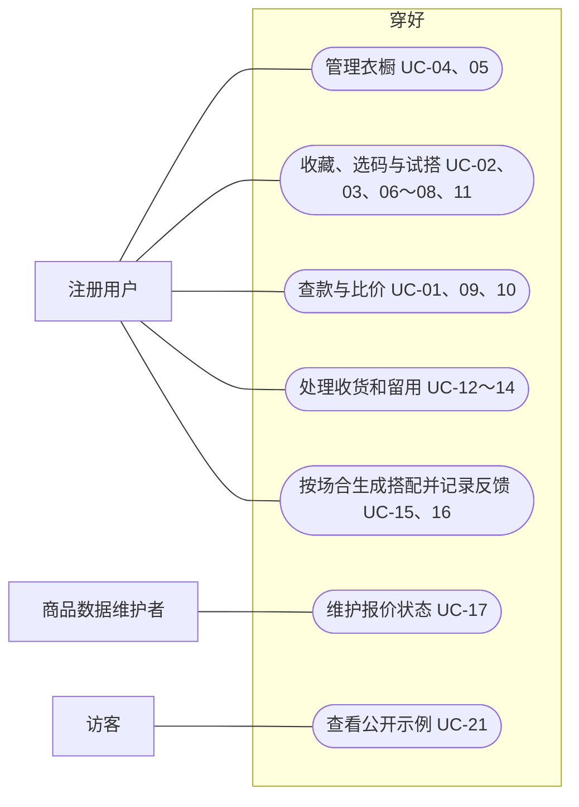

# 穿好软件需求规格说明书

状态：第三课组内评审草稿。需求分析负责人已确认 US-01 为比价增量必做项。其余需求与角色待团队确认。外部接入由架构负责人提出方案，性能验收口径由测试／质量负责人复核。教师评审签字后定稿为 SRS v1.0。

## 目标与范围

帮助买衣用户使用个人衣橱和参考衣物做购前判断，对指定规格比较可核实报价，确认留用后找回并继续使用原搭配。依据见[调研报告](research-report.md)、[访谈纪要](用户调研访谈纪要.md)与[竞品实测](竞品任务实测.md)。

下表引用项目 README 的增量设想，便于查看需求归属。正式排期由组长协调。

| 增量 | 拟交付的业务闭环 |
| --- | --- |
| v0.1 | 录入个人衣物、标记可穿状态，按用户手填的场合和条件组一套衣物并替换单品。 |
| v0.2 | 收藏候选、尺码对照、利用自有衣物试搭、按同一规格核实和比较报价。 |
| v0.3 | 确认留用后复用购前搭配，处理退货并记录实际穿着反馈。 |

比价首轮可用可追溯报价快照验收，历史与模拟样本明确标注。价格字段含来源、适用规格、库存或未知状态、优惠适用条件、运费和核实时间。已过期、缺货或未核实的记录不参加当前有效报价排序。实际支付在商家侧完成。尺码判断只使用可比较的数据，搭配以单品组合展示，实际合身和特定光照下的效果由用户试穿确认。

v0.1 支持手填“下雨”“需要步行”等条件。自动读取天气和日程延后。定时复核报价提醒（US-18／FR-18／UC-18）是后续候选，不计入本期基线。课程要求的外部集成项由架构负责人另行明确。

本期保存已知候选的截图或链接（UC-06），也可按已知款号查询（UC-09）；尺码比对使用旧衣成衣尺寸（UC-02、UC-03）；反馈可保存并回看（UC-16）。身材档案选码、拍照或自然语言找新款、自动学习和编辑系统记住的偏好均留到后续增量。

## 参与者和权限

| 参与者 | 职责和权限 |
| --- | --- |
| 注册用户 | 管理本人的衣橱、候选、搭配和反馈，查询可公开提供的报价。 |
| 访客 | 只查看公开示例，无权访问私人衣橱、照片或搭配。 |
| 商品数据维护者 | 只更新报价状态，无权访问用户私人衣橱。 |

## 用例图

## 功能需求和验收标准

本期共 21 个用例，其中 18 个功能用例、3 个非功能需求用例，分别覆盖性能、安全和可用性（故障恢复）。符合《软件工程课程设计要求（版本2）》第 2 页 §2.1 的数量下限；第三类需求按 [PR #34 的第二课评审意见](https://github.com/MXH814/DressWell/pull/34#pullrequestreview-6076008560)补充。用户故事、需求、用例和 GitHub 跟踪信息见[需求追溯矩阵 v0](requirements-traceability.md)。

| 需求 ID | 用例 | 用户故事 | Given | When | Then | 证据 |
| --- | --- | --- | --- | --- | --- | --- |
| FR-01 | UC-01 | 买家希望比较指定规格的到手价，减少在多个结算页间切换。 | 同款黑色 M 码两家有货，甲店 159 元、用户可用 10 元券，乙店黑色 155 元、灰色 139 元起，两家均包邮。 | 比较黑色 M 码。 | 显示 149 元和 155 元，按价排序时甲店在前，139 元不参与。 | A03、C01 |
| FR-02 | UC-02 | 买家希望用合身旧衣对照成衣尺寸，知道值得先试哪个码。 | 旧夹克腋下平铺宽 57 cm，新款 L 码成衣胸围为 114 cm。 | 按胸围对照。 | 展示换算过程并标记 L 码胸围一致，同时提示未核对的肩宽及袖长。 | A01 |
| FR-03 | UC-03 | 买家希望知道尺码资料缺了什么，避免误选。 | 旧衣为成衣尺寸，商品只给人体胸围或未注明口径。 | 请求对照。 | 标出不可比较的原因和缺项，暂停基于该项的建议。 | A01、A04 |
| FR-04 | UC-04 | 用户希望登记常穿衣物，供后续试搭。 | 用户有一件夹克的照片。 | 输入类别并保存。 | 衣橱新增一个单品，可查看和修改类别。 | A01、A02、C03 |
| FR-05 | UC-05 | 用户希望今天穿不了的衣物不进入搭配。 | 米白裙已标记为不可穿。 | 从衣橱生成搭配。 | 裙子未被推荐，仍可在个人衣橱中管理。 | A02 |
| FR-06 | UC-06 | 买家希望保存候选和出处，方便稍后查看。 | 用户有待购上衣的截图或商品链接。 | 保存候选。 | 能重新打开该候选并查看所保存的来源，候选还未进入可穿衣橱。 | A02；C02 仅提供官网资料和登录门槛的观察 |
| FR-07 | UC-07 | 买家希望用已有衣物试搭候选，判断买回去能不能穿。 | 用户有待购上衣和已确认可穿的裤子、鞋。 | 将所选单品组成一套并保存，再重新打开。 | 仍能找回原组合，且可区分待购单品和自有单品。 | A02、A06、C03 |
| FR-08 | UC-08 | 用户希望只换不合适的单品，保留已经选好的衣服。 | 搭配中的裤子已被锁定，衣橱内另有一双可用鞋。 | 请求保持裤子、换鞋。 | 裤子保持原选择，显示替代鞋；没有候选时提示缺项。 | A06、C03 |
| FR-09 | UC-09 | 回购用户希望凭款号找回同款，避免重新找款。 | 旧链接失效，仍有款号。 | 按款号搜索。 | 有匹配时展示匹配项，无结果时提示未找到并保留查询款号。 | A05、C01 |
| FR-10 | UC-10 | 买家希望识别过期或未经核实的报价，避免用旧价下单。 | 一条目标规格历史活动已过期，另一条只显示起售价。 | 查看当前有效报价。 | 分别标记「已失效」和「待核实」，显示来源和核实信息，两条都不参加当前价格排序。 | A03、C01 |
| FR-11 | UC-11 | 用户希望知道搭配建议有哪些条件要实际试穿。 | 衬衫尺寸合适，缺少透光资料。 | 查看面试搭配。 | 单独展示尺寸对照结果，提示透光性待试穿确认。 | A04 |
| FR-12 | UC-12 | 买家希望登记已下单的候选，以便收货后继续原先的搭配。 | 已有候选及买前方案。 | 标记已买待收。 | 状态更新，原方案仍可打开，衣物尚未进入可穿列表。 | 待验证假设：尚无证据表明用户会主动维护待收状态。见 [US-12 验证计划](https://github.com/MXH814/DressWell/issues/25)。 |
| FR-13 | UC-13 | 用户希望确认留用时复用买前材料和搭配。 | 候选有已核实款号、色码、图片和已存四件搭配。 | 确认留用并重新打开已存搭配。 | 同一候选成为可穿单品，原有图片、已核实规格和整套搭配都可找回，无需再录入。 | C03；留用是项目拟实现流程 |
| FR-14 | UC-14 | 用户希望退货后该衣物不再出现在推荐里。 | 路径 A：候选为已买待收，试穿后决定直接退货。路径 B：确认留用入橱后决定退货。 | 分别登记退货并请求搭配。 | 两条路径均可查看已退货状态，后续可穿推荐均排除该件。 | A04 |
| FR-15 | UC-15 | 用户希望按场合和手填条件从衣橱选一套能穿的衣服。 | 有可穿衣物，用户填写通勤场合以及“下雨”“需要步行”等条件。 | 请求生成搭配。 | 返回由可穿单品组成的方案，说明如何照顾场合和已填条件；无法满足时提示缺项。 | A01、A06 |
| FR-16 | UC-16 | 用户希望保留实际试穿反馈，以后能回看。 | 有一套由牛仔裤和帆布鞋组成的方案。 | 保存「裤脚蹭地」反馈。 | 重新打开该组合时能看到反馈及所涉及的单品。 | A06 |
| FR-17 | UC-17 | 数据维护者希望撤下失效报价，避免误导用户。 | 有仍展示为有效的报价，维护者已确认商家链接失效。 | 将报价改为失效。 | 报价退出有效排序，仍可查到来源和状态变更；维护者无权读取或修改私人衣橱。 | C01；角色评审 |
| FR-19 | UC-21 | 访客希望先查看公开示例，了解产品能提供什么。 | 未登录访客可打开公开示例入口，并获得一个私人衣橱或搭配的地址。 | 先打开公开示例，再尝试直接访问该私人内容。 | 公开示例正常展示；私人衣橱、搭配及相关照片均不返回。 | 第三周角色评审 |

**UC-01 补充场景：优惠资格或运费未知。** Given 目标规格已核实，标价可见，但用户能否使用优惠券或运费金额未知。When 用户查看该报价并比较。Then 显示可核实金额及具体待确认项，不将其作为已核实到手价参与排序；当券资格或运费补齐、到手价可核实且报价仍有效时，再纳入排序。

## 非功能需求用例和验收标准

| 需求 ID | 用例 | 质量目标 | Given | When | Then |
| --- | --- | --- | --- | --- | --- |
| NFR-01 | UC-19 | 查询已采集报价时，结果应及时可见。 | 测试库固定 100 条已采集报价，其中目标规格有两条已核实有效报价，其余为干扰记录；查询只读快照。客户端网络限制为下行 20 Mb/s、上行 5 Mb/s、往返时延 50±10 ms。 | 5 个已登录会话同时提交目标规格查询，全部结束后开始下一轮，共 4 轮、20 次。从用户点击「查询」计时，到正确报价列表完整可见结束，每次最多等 10 秒。 | 20 次都必须显示正确报价、顺序和来源，且至少 19 次耗时不超过 2 秒才通过。任一错误、超时或达标次数不足即失败。 |
| NFR-02 | UC-20 | 私人衣物照片只向本人开放。 | 甲有一张私有衣物照片，甲、乙使用不同账号，乙拿到照片标识。 | 乙请求访问该照片，随后甲访问同一照片。 | 乙无法获得图片内容，甲正常查看。 |
| NFR-03 | UC-22 | 网络中断后，用户可恢复已确认保存的购前搭配。 | 同一测试账号有 10 套已保存搭配，目标搭配已确认保存，包含一件待购款和两件自有单品。记录原搭配的标识、各单品及状态、待购款规格。断网至少 10 秒并在断网期间关闭应用，无其他设备改写。 | 恢复至下行 20 Mb/s、上行 5 Mb/s、往返时延 50±10 ms；使用原账号重开应用。从点击「已保存搭配」到原搭配信息完整可见计时。在同一初始数据下独立重复 3 轮。 | 三轮均须在 30 秒内找回才通过。每轮原搭配只出现一次，标识、待购款规格、三件单品及状态与断网前一致；任一轮超时、重复、缺项或状态不同即失败。 |

UC-19 和 UC-22 给出可执行、可判定的验收草案。样本规模、网络参数和通过阈值是本轮提出的值，尚待需求负责人和测试／质量负责人确认。

## 三个细化场景

| 用例 | 主参与者与前提 | 正常流程 | 备选流程 |
| --- | --- | --- | --- |
| UC-07 购前试搭 | 注册用户，已有候选和个人衣橱。 | 打开候选 → 选择可穿单品 → 查看组合 → 保存方案。 | 想搭的单品不可穿时给出替代项，无替代项时说明缺少哪类单品。 |
| UC-01 指定规格比价 | 注册用户，已确定款号、颜色、尺码。 | 提交规格 → 核对商品身份、库存和有效状态 → 核算用户可享价格与运费 → 显示排序及来源。 | 优惠资格、运费或规格待确认时显示已知金额和待确认项，补齐前不参与排序。失效记录单独显示；零条有效报价时说明当前无可比报价。 |
| UC-13 留用后找回搭配 | 注册用户，已下单，且有已保存的购前搭配。 | 打开候选 → 确认留用 → 该候选成为可穿衣物 → 打开原方案核对图片和规格。 | 放弃留用或退货时保留状态，候选不得出现在新的可穿推荐里。 |

## 评审与变更

需求分析负责人整理用例、业务验收条件、角色权限和追溯关系，并维护 AI 使用台账。测试／质量负责人根据 SRS 编写正式测试与验收用例并组织评审。架构负责人提出外部接入方案，组长协调分工、迭代计划与发布。每条需求 Issue 应关联用例编号；负责人和增量按实际分工登记。需求变更由申请人在 Issue 写明原因及影响，团队评审批准后由 PR 更新规约、用例和追溯关系。教师评审签字后，记录修改事项及 PR，由发布负责人发布 SRS v1.0。

| 版本 | 变更 | 评审 |
| --- | --- | --- |
| 评审草稿 | 将 A01–A06 与 C01–C03 汇入需求和用例，增加对过期报价、证据范围和资料复用的验收条件。 | 待组内复核、课堂评审及签字。 |
| 第三周组内意见修订 | 补齐比价异常、原搭配找回、两条退货路径及访客权限；提醒转为后续候选，v0.1 使用手填搭配条件。 | 胡知鱼评审结论为“按意见修改后复核”。本轮已按反馈修订，待组内复核与课堂评审。 |
| 第二课要求补遗 | 补足可用性恢复用例，逐条关联证据与故事 Issue，区分第二课讲解和第三课需求评审。 | 恢复与性能阈值均为讨论口径，证据独立复核和需求标准的人为确认仍待记录。 |
| 11 月 27 日复审修订 | 把查价性能和断网恢复写成可判定通过或失败的验收草案，统一 SRS 和首页的交付范围。 | [组长复审](https://github.com/MXH814/DressWell/pull/34#pullrequestreview-6083741806)。本轮验收口径与需求范围待人工确认。 |
